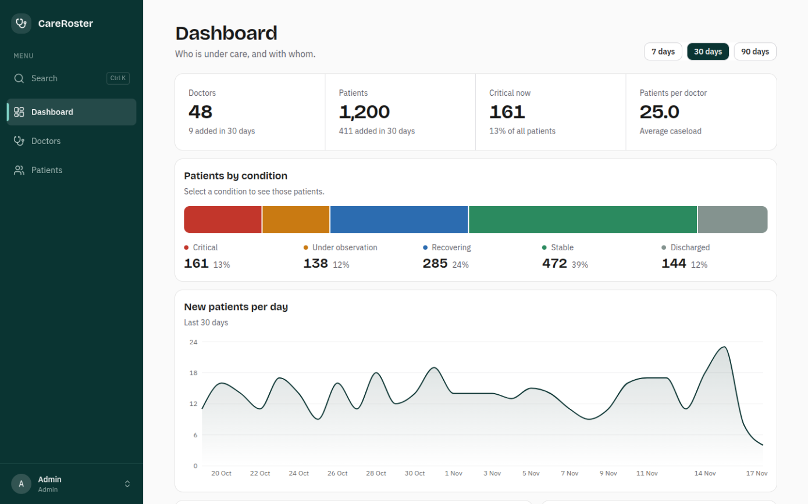
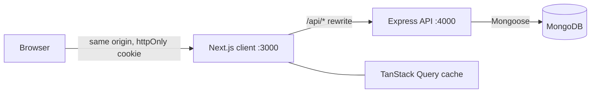
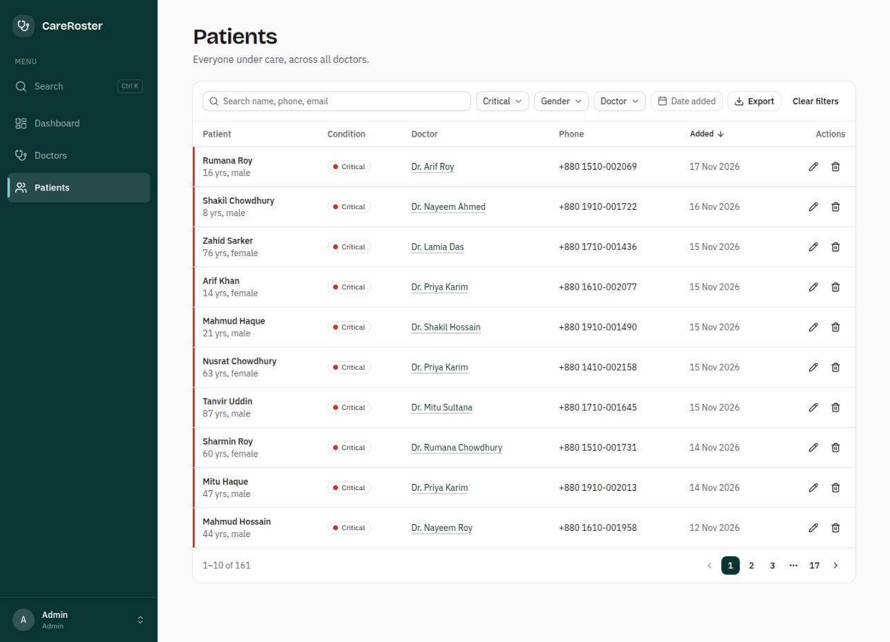
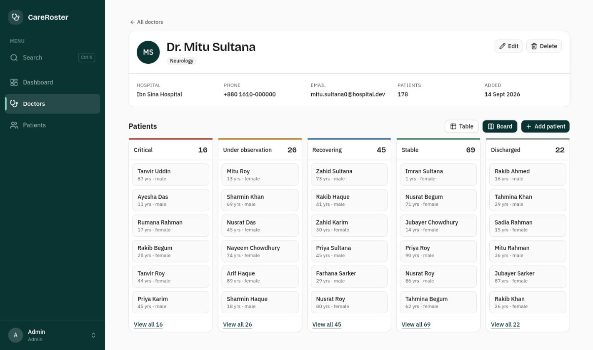
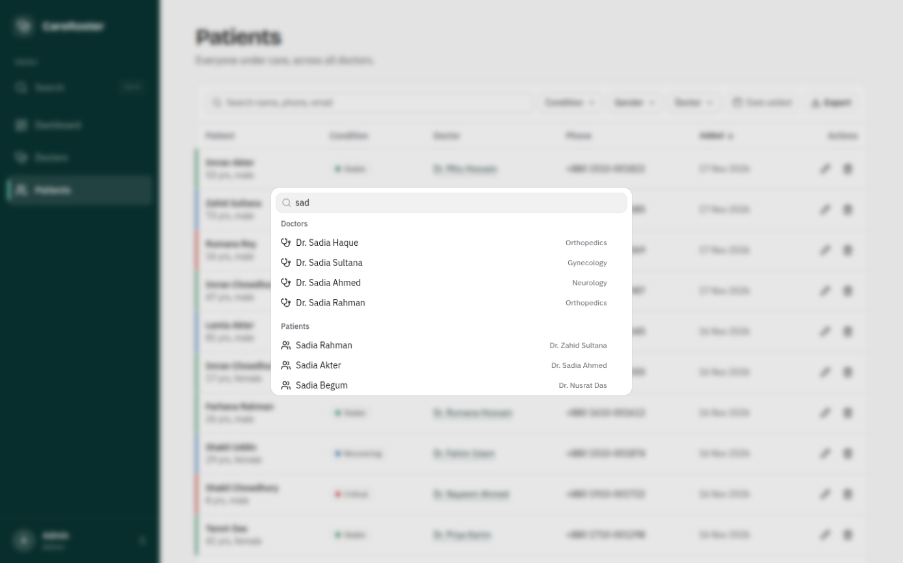

# CareRoster

**Doctors and patients, one roster.** A hospital admin portal with search, filters, sorting, a triage board and a ward dashboard.



## Description

CareRoster is a secure administrative web application for hospital staff to manage doctors and the patients under their care. An administrator signs in, adds doctors, opens any doctor to add, edit, reassign or remove their patients, and works through the full patient list with search, filters, sorting and pagination, while a dashboard turns the same data into a ward-board view: how many patients each doctor carries, how many are critical right now, and how admissions move day by day. It is built as two independent applications, a Next.js client and an Express REST API on MongoDB, and every list query is backed by an index.

**Beyond the brief**

- **Triage board.** A doctor's patients can be viewed as lanes by condition (Critical, Under observation, Recovering, Stable, Discharged) instead of a table.
- **Command palette (`Ctrl K`).** One box searches doctors and patients through the API and jumps to pages and saved views such as Critical or Unassigned patients.
- **Safe removals.** Deleting a doctor, or removing a patient from a doctor's list, keeps the patient record and marks it *Unassigned*; it can be reassigned later ([ADR 0006](docs/adr/0006-delete-doctor-unassigns-patients.md)).
- **Roles that mean something.** `staff` accounts are read-only, enforced by the API, not just by hiding buttons ([ADR 0005](docs/adr/0005-staff-read-only-role-enforced-server-side.md)).
- **Real mobile layout.** Tables become cards, filters collapse to one compact row, navigation is a bottom tab bar.
- **CSV export** of exactly what the filters show, and URL-driven list state, so every view is a shareable link.
- **Evidence for the performance claims.** `npm run db:explain` prints the query plan and documents examined for every hot query ([results](#query-performance)).

**Demo accounts** (also one-click buttons on the sign-in screen)

| Role | Email | Password | Can |
| --- | --- | --- | --- |
| Admin | `admin@carerooster.dev` | `Admin@12345` | Everything: add, edit, reassign, delete |
| Staff | `staff@carerooster.dev` | `Staff@12345` | Read everything; every change returns `403` |

## Setup Guide

Requirements: Node.js 20.19+ and Docker (or any MongoDB 6+).

The repository holds two separate applications. Each has its own `package.json`, dependencies and environment file; there is no root package or workspace.

```
.
├── client/              Next.js app (UI)
├── server/              Express REST API
├── docker-compose.yml   MongoDB for development, or the whole stack
└── docs/                architecture, ADRs, OpenAPI, deployment, screenshots
```

**1. Start MongoDB**

```bash
docker compose up -d mongo
```

**2. Start the API** (terminal 1)

```bash
cd server
cp .env.example .env      # then replace each $PLACEHOLDER, see below
npm install
npm run seed              # 2 users, 48 doctors, 1,200 patients
npm run dev               # http://localhost:4000
```

[`server/.env.example`](server/.env.example) is a template whose values are `$PLACEHOLDERS` (CI fills the same file with `envsubst` when it deploys). For local development the finished `server/.env` looks like this:

```bash
NODE_ENV=development
PORT=4000
MONGO_URI=mongodb://localhost:27017/carerooster
JWT_SECRET=<32+ random characters: openssl rand -hex 32>
JWT_EXPIRES_IN_HOURS=8
CLIENT_ORIGIN=http://localhost:3000
TRUST_PROXY=1
```

The API refuses to start while `MONGO_URI` or `JWT_SECRET` is still a `$PLACEHOLDER` or the secret is shorter than 32 characters.

**3. Start the client** (terminal 2)

```bash
cd client
cp .env.example .env.local   # API_URL=http://localhost:4000
npm install
npm run dev                  # http://localhost:3000
```

**4. Sign in** at http://localhost:3000 with one of the demo accounts above.

**Everything in containers instead**

```bash
JWT_SECRET=$(openssl rand -hex 32) docker compose up -d --build
docker compose --profile seed run --rm seed      # demo data: wipes the database first
```

Over plain `http` the API runs with `NODE_ENV=development` (the production-only `Secure` cookie flag would otherwise block sign-in); set `NODE_ENV=production` when serving over HTTPS.

### Environment variables

| App | Variable | Purpose |
| --- | --- | --- |
| `server/.env` | `MONGO_URI` | MongoDB connection string (include the database name) |
| | `JWT_SECRET` | Signs session tokens, minimum 32 characters |
| | `JWT_EXPIRES_IN_HOURS` | Session lifetime (default 8) |
| | `CLIENT_ORIGIN` | Origin allowed by CORS (default `http://localhost:3000`) |
| | `PORT` | API port (default 4000) |
| | `TRUST_PROXY` | Proxy hops in front of the API (default 1; see [deployment](docs/deployment.md)) |
| | `NODE_ENV` | `production` enables the `Secure` cookie flag and disables index auto-build |
| | `SEED_ADMIN_EMAIL`, `SEED_ADMIN_PASSWORD` | Optional, not in `.env.example`: override the seeded admin |
| | `SEED_ALLOW_PRODUCTION` | `true` lets `seed` run when `NODE_ENV=production` (it wipes the database) |
| `client/.env.local` | `API_URL` | Where the client forwards `/api/*` (default `http://localhost:4000`) |

### Scripts

| | `server/` | `client/` |
| --- | --- | --- |
| Develop | `npm run dev` | `npm run dev` |
| Test | `npm test` | `npm test` |
| Type-check | `npm run typecheck` | `npm run typecheck` |
| Lint | | `npm run lint` |
| Production | `npm run build && npm start` | `npm run build && npm start` |
| Database | `npm run seed`, `db:indexes`, `db:explain` | |

`db:indexes` syncs the declared indexes (run it on deploy; `autoIndex` is off in production). `db:explain` prints the query plans.

## System Architecture



**Request flow.** The browser only ever talks to the Next.js origin, which forwards `/api/*` to the Express server by a rewrite. The API validates input with Zod, runs an indexed query, and answers in one of two shapes: `{ data, meta? }` on success or `{ error: { code, message, details? } }` on failure. TanStack Query caches the response under a key built from the resource and the URL parameters. More diagrams (container, login and 401 sequence, ER model, request lifecycle) are in [docs/architecture.md](docs/architecture.md).

**Authentication and authorization.** `POST /api/auth/login` checks the bcrypt hash and sets a JWT in an `httpOnly`, `SameSite=Lax` cookie (also `Secure` in production). Protection is layered:

1. `proxy.ts` in the client redirects visitors without a session cookie to `/login`. This is a convenience, not a boundary.
2. Every resource route on the API passes `requireAuth`. `GET`/`HEAD` are open to any signed-in user; every other method also needs the `admin` role. This is the security boundary.
3. If a session expires mid-use the API answers `401` and clears the cookie; the client returns the user to the page they were on after sign-in.

Login is limited to 20 attempts per 15 minutes per IP, the whole API to 300 requests per minute per IP, and an unknown email costs the same bcrypt comparison as a wrong password, so response time does not reveal which emails exist.

**Code layout**

```
server/src
├── app.ts               middleware and route wiring
├── server.ts            connect, listen, graceful shutdown
├── config/env.ts        environment validation (fails fast)
├── middleware/          auth (JWT, roles), error handler
├── modules/             auth · doctors · patients · dashboard (model, service, routes)
├── utils/               search tokens, pagination, shared Zod pieces
└── scripts/             seed, db-indexes, db-explain

client/src
├── proxy.ts             optimistic route protection
├── app/                 routes: /login, /, /doctors, /doctors/[id], /patients
├── features/            auth, doctors, patients, dashboard
├── components/ui/       shadcn/ui primitives
├── components/app/      DataTable, filters, export, dialogs, form fields (built from ui/)
├── components/shell/    sidebar, bottom tab bar, command palette
├── hooks/               URL list state, sorting, form submission
└── lib/                 API client, query hooks, CSV, formatting
```

## Technical Decisions

Nine decisions are written up as ADRs ([index](docs/adr/README.md)). The two that shape the code most are explained here in full.

### 1. Search with indexed prefix tokens instead of `$regex` or `$text`

The search boxes are search-as-you-type across several fields (a doctor's name, specialization, hospital, email and phone). The two obvious MongoDB options both fall short:

- **Case-insensitive `$regex` on each field** (`{ name: /car/i }` in an `$or`) gives the right behaviour but cannot use an index. Every keystroke scans the whole collection, and the cost grows linearly with the data.
- **A `$text` index** is fast but matches whole words only. Typing `cardio` finds nothing until the user finishes typing `cardiology`, which is poor UX for a live search box.

Instead, each document stores a `searchTokens` array: the lowercased words of its searchable fields, written by a Mongoose `pre('validate')` hook and covered by a multikey index. A query is split into terms and each term becomes an anchored, case-sensitive prefix match:

```js
// "neuro ibn" →
{ $and: [{ searchTokens: /^neuro/ }, { searchTokens: /^ibn/ }] }
```

An anchored prefix regex on an indexed field is answered with an index range scan, so the search is both partial-word and index-backed. User input is regex-escaped, and the number of terms is capped at five.

**Trade-offs.** Documents are slightly larger and there is one extra index to maintain on writes. Matching is by word prefix, not arbitrary substring (`ology` will not find `Cardiology`). Updates must go through `save()` so the hook runs, which the services do. Because a multikey token index cannot also provide the date order, a search sorts its matches in memory; the match count bounds that cost. A test asserts through `explain()` that search and filtered lists never fall back to a `COLLSCAN`. If typo tolerance or relevance ranking is needed later, Atlas Search is the next step, and only `utils/search.ts` would change. Full write-up: [ADR 0001](docs/adr/0001-search-with-indexed-prefix-tokens.md).

**The other indexes follow equality, then `createdAt`, then `_id`.** Every list is sorted newest first, so each filter index ends in the sort key (`{ specialization: 1, createdAt: -1, _id: -1 }`, `{ doctor: 1, createdAt: -1, _id: -1 }`, `{ condition: 1, createdAt: -1, _id: -1 }`). MongoDB returns a filtered page already sorted, with no in-memory sort. The `_id` tiebreaker keeps pagination stable when timestamps collide: a bulk import would otherwise repeat or skip rows between pages, and a test inserts twelve doctors with one timestamp to prove it does not. Patient counts for a page of doctors come from one grouped query over the `doctor` index rather than a lookup per row ([ADR 0002](docs/adr/0002-index-design-and-stable-pagination.md)).

### 2. TanStack Query with URL state instead of Redux, behind a same-origin API proxy

Almost all state in this app is server state: lists, a doctor, dashboard numbers. Redux would mean hand-writing loading, error, caching and invalidation logic for each of them. TanStack Query provides those as a cache keyed by request:

- **Smooth pagination.** `keepPreviousData` keeps the current page visible, dimmed, while the next one loads, so the table never collapses into a spinner.
- **Fewer requests.** Results stay fresh for 30 seconds; going back to a page paints from cache. In-flight requests are cancelled when filters change.
- **Simple, correct invalidation.** Any write marks doctors, patients and dashboard stale, because counts appear in all three. Only queries on screen actually refetch.

The remaining UI state, which is search text, filters, sort and page number, lives in the URL (`/patients?condition=critical&page=2`) through a small `useListParams` hook. A filtered view survives reload, works with the back button and can be shared as a link, and the dashboard's condition tiles are plain links into a pre-filtered patient list. Search input is debounced by 300 ms, so typing does not issue a request per keystroke. With the URL as the single source of truth there is no global client store at all ([ADR 0004](docs/adr/0004-url-as-list-state-with-tanstack-query.md)).

The client reaches the API through a Next.js rewrite (`/api/*` to the Express server) rather than calling it cross-origin. The frontend and backend remain separate deployable applications that communicate over REST, but from the browser's point of view there is one origin. That keeps the session cookie first-party, so `SameSite=Lax` works without `SameSite=None`, and removes CORS preflight requests. The cost is one extra network hop through the Next.js server ([ADR 0003](docs/adr/0003-same-origin-api-and-httponly-cookie.md)).

### Other decisions

- **Dashboard cache that cannot go stale.** The stats are several grouping queries, cached 60 s per range and cleared by any successful write. [ADR 0007](docs/adr/0007-dashboard-in-memory-cache.md)
- **Removing a doctor or unassigning a patient keeps the record**, instead of cascading. [ADR 0006](docs/adr/0006-delete-doctor-unassigns-patients.md)
- **Read-only `staff` role** enforced by the API. [ADR 0005](docs/adr/0005-staff-read-only-role-enforced-server-side.md)
- **`skip`/`limit` pagination** now, cursor pagination as the documented upgrade. [ADR 0008](docs/adr/0008-skip-limit-pagination.md)

[docs/trade-offs.md](docs/trade-offs.md) lists what each choice costs and the next step.

## Visual Evidence

### Desktop

| Sign in | Dashboard |
| --- | --- |
|  |  |

| Doctors (sorted by patient count) | Patients (filtered to Critical) |
| --- | --- |
|  |  |

| A doctor's patients as a triage board | Command palette (`Ctrl K`) |
| --- | --- |
|  |  |

### Mobile

| Sign in | Dashboard | Doctors | Patients |
| --- | --- | --- | --- |
|  |  |  |  |

On phones tables become cards, the filters fit one compact row, and navigation moves to a bottom tab bar.

## Query performance

`npm run db:explain` runs each hot query with `explain('executionStats')`. Output on the seeded dataset (48 doctors, 1,200 patients, page size 10, sorted newest first):

| Query | Plan | Keys examined | Docs examined | Returned |
| --- | --- | ---: | ---: | ---: |
| Doctors, list | IXSCAN `createdAt_-1__id_-1` | 10 | 10 | 10 |
| Doctors, by specialization | IXSCAN `specialization_1_createdAt_-1__id_-1` | 7 | 7 | 7 |
| Doctors, by hospital | IXSCAN `hospital_1_createdAt_-1__id_-1` | 10 | 10 | 10 |
| Doctors, search `dr ay` | IXSCAN `searchTokens_1`, then in-memory sort | 2 | 1 | 1 |
| Patients, list | IXSCAN `createdAt_-1__id_-1` | 10 | 10 | 10 |
| Patients, by doctor | IXSCAN `doctor_1_createdAt_-1__id_-1` | 10 | 10 | 10 |
| Patients, by condition | IXSCAN `condition_1_createdAt_-1__id_-1` | 10 | 10 | 10 |
| Patients, search `ay` | IXSCAN `searchTokens_1`, then in-memory sort | 54 | 53 | 10 |

Every query uses an index and none scans the collection: a filtered or paged list examines only the rows it returns. Other query decisions: the dashboard joins only its ten displayed rows; sorting doctors by patient count computes counts with an indexed `$lookup` only when that sort is chosen.

## Frontend performance

- **No needless re-renders.** Table columns and callbacks are memoised, so the table and search box do not re-render on unrelated state changes; the search box is debounced and follows URL changes without an effect.
- **Smooth data fetching.** Cached pages paint instantly, previous data stays on screen while the next page loads, and in-flight requests are cancelled when filters change.
- **Small first load.** The charting library loads with `next/dynamic` only on the dashboard, after the shell has painted. Loading states are skeletons shaped like the content, so layout does not jump.
- **Reusable components.** One `DataTable` renders every list (table on desktop, cards on phones); filters, pagination, dialogs, form fields and the CSV export are shared by the doctor and patient screens.

## API

Full spec: [docs/openapi.yaml](docs/openapi.yaml) (OpenAPI 3.1).

| Method | Path | Purpose |
| --- | --- | --- |
| POST | `/api/auth/login` · `/api/auth/logout` | Start and end a session |
| GET | `/api/auth/me` | Current user |
| GET, POST | `/api/doctors` | List (search, filters, sort, pagination) · create |
| GET | `/api/doctors/filters` | Distinct specializations and hospitals |
| GET, PATCH, DELETE | `/api/doctors/:id` | Read · update · delete (their patients become unassigned) |
| GET, POST | `/api/doctors/:id/patients` | A doctor's patients · add a patient under the doctor |
| DELETE | `/api/doctors/:id/patients/:patientId` | Unassign a patient from that doctor's list (the record is kept) |
| GET | `/api/patients` | List (search, filters, sort, pagination) |
| PATCH, DELETE | `/api/patients/:id` | Edit or reassign (`doctor` id, or `null` to unassign) · delete the record |
| GET | `/api/dashboard/stats?days=30` | Totals, breakdowns and daily timeline (cached 60 s) |
| GET | `/api/health` | Readiness: `200`, or `503` when MongoDB does not answer |

List endpoints accept `page`, `limit` (max 100), `search`, `from`, `to`, `order=asc|desc`, plus `sort=createdAt|patients`, `specialization`, `hospital` for doctors and `condition`, `gender`, `doctor` (an id or `unassigned`) for patients. Input is validated with Zod and rejected with a `400` that lists the failing fields.

## Testing and CI

- **Server, 45 tests** (Vitest + Supertest on an in-memory MongoDB): authentication, the staff read-only rule, validation errors, doctor and patient CRUD, search, every filter and sort, stable pagination under colliding timestamps, delete-and-unassign, dashboard aggregation and cache invalidation, the global rate limit, health, and the query-plan test.
- **Client, 23 tests** (Vitest + Testing Library): the API wrapper, query-string, pagination and CSV helpers (including formula neutralisation), and the `DataTable`, `ListPagination`, `SearchInput` and `LoginForm` components.
- **CI** ([.github/workflows/ci.yml](.github/workflows/ci.yml)) runs on every push and pull request: type-check, test and build for the server; lint, type-check, test and build for the client.

The first server test run downloads a MongoDB binary (about 100 MB, cached afterwards).

## Deployment

The client deploys to Vercel through its Git integration, and the API to a VPS under pm2 from a GitHub Actions workflow that renders the API's environment file from `.env.example` with the repository's secrets and variables. Steps, the full secrets and variables list, nginx and TLS, and rollback are in [docs/deployment.md](docs/deployment.md).

## Scalability considerations

- **Stateless API.** The JWT carries the session, so instances can be added behind a load balancer. Two things live in process memory today, the dashboard cache and the rate limits, so the API runs as one process until both move to a shared store such as Redis.
- **Indexes** cover every list, filter, sort and search path (table above); in production `autoIndex` is off and `db:indexes` builds them as a deployment step.
- **Pagination.** Lists use `skip`/`limit` because the UI needs numbered pages and a total. Deep pages get slower with `skip`; for very large collections, switch to cursor pagination on `(createdAt, _id)`, which the indexes already support.
- **Dashboard.** Aggregations run in the database in parallel and return only summaries; totals use `estimatedDocumentCount`; the response is cached for a minute and cleared on every write. At millions of rows, maintain counters instead of grouping.
- **Deleting a doctor** unassigns their patients first, then removes the doctor, without a transaction (transactions need a replica set); a failure in between leaves a state a retry resolves.

Each is listed with its trigger and next step in [docs/trade-offs.md](docs/trade-offs.md).

## Security notes

- Session in an `httpOnly`, `SameSite=Lax` cookie (`Secure` in production); `helmet`; JSON body limit 100 kB; every list query is validated by Zod, with `limit` capped at 100.
- Search input is regex-escaped and limited to five terms; CSV export neutralises spreadsheet formulas.
- Roles are enforced in the API. The JWT carries the role, so a role change takes effect at the next sign-in.
- Rate limits: login 20 per 15 minutes, API 300 per minute, per IP. Both are per process.
