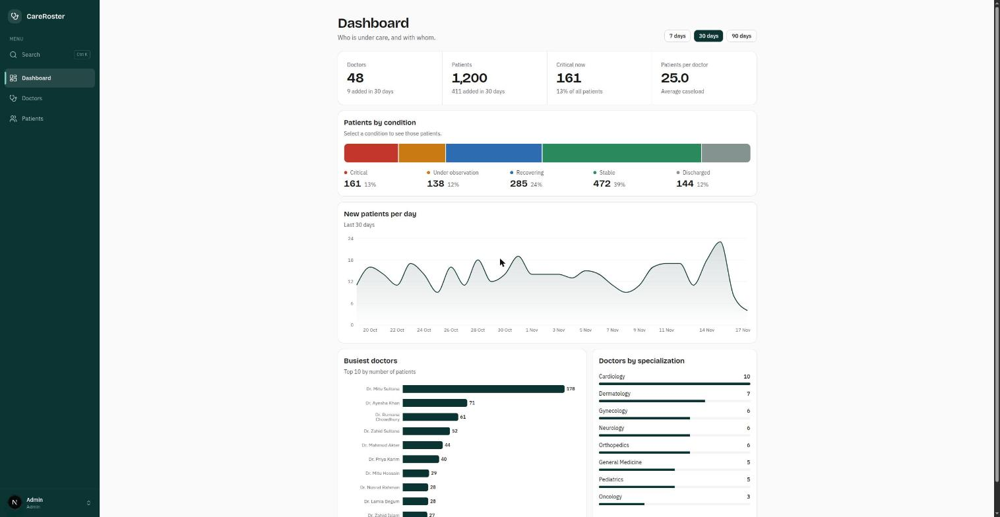
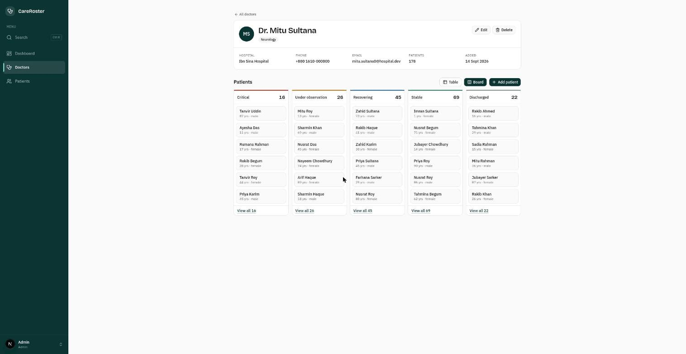
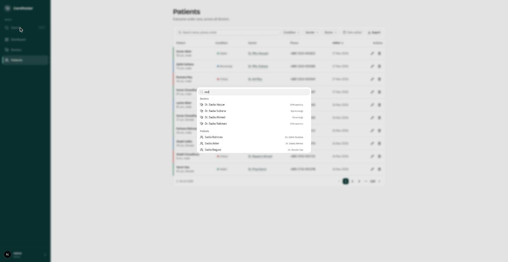
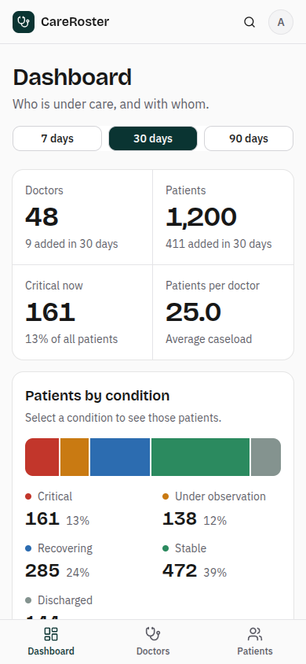
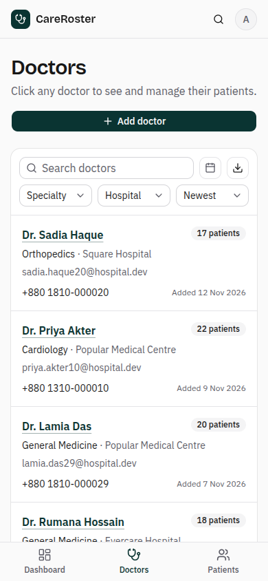
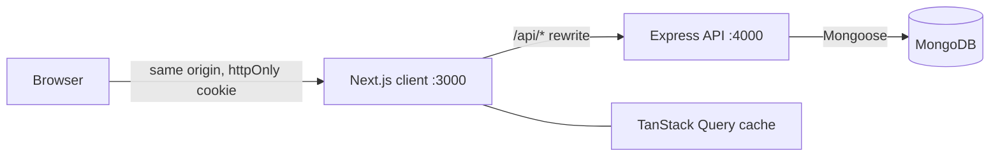

# CareRoster

A hospital admin portal for managing doctors and the patients under their care. Search, filter, sort and export every list, see the whole ward on one dashboard, and jump anywhere with `Ctrl K`.

| Dashboard | Doctor, as a triage board |
| --- | --- |
|  |  |

| Command palette |
| --- |
|  |

| Dashboard | Doctors | Patients |
| --- | --- | --- |
|  |  |  |

More: [doctors list](docs/screenshots/doctors-desktop.jpg), [patients list](docs/screenshots/patients-desktop.jpg).

## Description

An administrator signs in, adds doctors, opens a doctor to add, edit, reassign or remove their patients, and works through the full patient list with search, filters, sorting and pagination. A dashboard turns the same data into a ward-board view: how many patients each doctor carries, how many are critical right now, and how admissions move day by day. It is two independent applications, a Next.js client and an Express REST API on MongoDB, and every list query is backed by an index.

**What is different from a standard CRUD admin**

- **Triage board.** A doctor's patients can be viewed as lanes by condition (Critical, Under observation, Recovering, Stable, Discharged) instead of a table.
- **Command palette (`Ctrl K`).** One box searches doctors and patients through the API and jumps to pages and saved views such as Critical or Unassigned patients.
- **Safe deletes.** Deleting a doctor keeps their patients and marks them *Unassigned*; they can be reassigned later ([ADR 0006](docs/adr/0006-delete-doctor-unassigns-patients.md)).
- **Roles that mean something.** `staff` accounts are read-only, enforced by the API, not just by hiding buttons ([ADR 0005](docs/adr/0005-staff-read-only-role-enforced-server-side.md)).
- **Real mobile layout.** Tables become cards, filters collapse to one compact row, navigation is a bottom tab bar.
- **CSV export** of exactly what the filters show, and URL-driven list state (every view is a shareable link).
- **Evidence for the performance claims.** `npm run db:explain` prints the query plan and documents examined for every hot query ([results below](#query-performance)).

## Quick start

Requirements: Node.js 20.19+ and Docker (or any MongoDB 6+).

**Everything in containers**

```bash
JWT_SECRET=$(openssl rand -hex 32) docker compose up -d --build
docker compose --profile seed run --rm seed      # demo data: wipes the database first
```

Open http://localhost:3000. Over plain `http` the API runs with `NODE_ENV=development` (the production-only `Secure` cookie flag would otherwise block sign-in); set `NODE_ENV=production` when serving over HTTPS.

**Local development** (MongoDB in Docker, apps from source)

```bash
docker compose up -d mongo

cd server
cp .env.example .env      # set JWT_SECRET to a random string of 32+ characters
npm install
npm run seed              # 2 users, 48 doctors, 1,200 patients
npm run dev               # http://localhost:4000

cd ../client              # second terminal
cp .env.example .env.local
npm install
npm run dev               # http://localhost:3000
```

### Demo accounts

The sign-in screen has a one-click button for each; the same credentials work by hand.

| Role | Email | Password | Can |
| --- | --- | --- | --- |
| Admin | `admin@carerooster.dev` | `Admin@12345` | Everything: add, edit, reassign, delete |
| Staff | `staff@carerooster.dev` | `Staff@12345` | Read everything; every change returns `403` |

### Environment variables

| App | Variable | Purpose |
| --- | --- | --- |
| `server/.env` | `MONGO_URI` | MongoDB connection string (include the database name) |
| | `JWT_SECRET` | Signs session tokens, minimum 32 characters; the server refuses to boot without it |
| | `JWT_EXPIRES_IN_HOURS` | Session lifetime (default 8) |
| | `CLIENT_ORIGIN` | Origin allowed by CORS (default `http://localhost:3000`) |
| | `PORT` | API port (default 4000) |
| | `NODE_ENV` | `production` enables the `Secure` cookie flag and disables index auto-build |
| | `SEED_ADMIN_EMAIL`, `SEED_ADMIN_PASSWORD` | Optional: override the seeded admin |
| `client/.env.local` | `API_URL` | Where the client forwards `/api/*` (default `http://localhost:4000`) |

### Scripts

| | `server/` | `client/` |
| --- | --- | --- |
| Develop | `npm run dev` | `npm run dev` |
| Test | `npm test` | `npm test` |
| Type-check | `npm run typecheck` | `npm run typecheck` |
| Lint | | `npm run lint` |
| Production | `npm run build && npm start` | `npm run build && npm start` |
| Database | `npm run seed`, `db:indexes`, `db:explain` | |

`db:indexes` syncs the declared indexes (run it on deploy; `autoIndex` is off in production). `db:explain` prints the query plans.

## System architecture



The browser only ever talks to the Next.js origin, which forwards `/api/*` to the Express server. The frontend and backend stay separately deployable, but the session cookie is first-party. The API validates input with Zod, runs an indexed query, and answers in one of two shapes: `{ data, meta? }` on success or `{ error: { code, message, details? } }` on failure.

More diagrams (container, login and 401 sequence, ER model, request lifecycle) are in [docs/architecture.md](docs/architecture.md).

**Authentication and authorization.** `POST /api/auth/login` checks the bcrypt hash and sets a JWT in an `httpOnly`, `SameSite=Lax` cookie (also `Secure` in production). Protection is layered:

1. `proxy.ts` in the client redirects visitors without a session cookie to `/login`. This is a convenience, not a boundary.
2. Every resource route on the API passes `requireAuth`. `GET`/`HEAD` are open to any signed-in user; every other method also needs the `admin` role. This is the security boundary.
3. If a session expires mid-use the API answers `401` and clears the cookie; the client returns the user to the page they were on after sign-in.

Login is limited to 20 attempts per 15 minutes per IP, the whole API to 300 requests per minute per IP, and an unknown email costs the same bcrypt comparison as a wrong password, so response time does not reveal which emails exist.

**Code layout**

```
server/src
├── app.ts               middleware and route wiring
├── server.ts            connect, listen, graceful shutdown
├── config/env.ts        environment validation (fails fast)
├── middleware/          auth (JWT, roles), error handler
├── modules/             auth · doctors · patients · dashboard (model, service, routes)
├── utils/               search tokens, pagination, shared Zod pieces
└── scripts/             seed, db-indexes, db-explain

client/src
├── proxy.ts             optimistic route protection
├── app/                 routes: /login, /, /doctors, /doctors/[id], /patients
├── features/            auth, doctors, patients, dashboard
├── components/ui/       shadcn/ui primitives
├── components/app/      DataTable, filters, export, dialogs, form fields (built from ui/)
├── components/shell/    sidebar, bottom tab bar, command palette
├── hooks/               URL list state, sorting, form submission
└── lib/                 API client, query hooks, theme, CSV, formatting
```

## Technical decisions

Each decision is written up as an ADR with context, the choice, trade-offs and alternatives; the [index](docs/adr/README.md) lists all nine. The ones that shape the code most:

- **Search uses indexed prefix tokens**, not `$regex` (collection scan on every keystroke) or `$text` (no partial words). Each document stores the lowercased words of its searchable fields in a multikey-indexed array; a query term becomes an anchored prefix match, which MongoDB answers from the index. [ADR 0001](docs/adr/0001-search-with-indexed-prefix-tokens.md)
- **Indexes are equality, then `createdAt`, then `_id`.** A filtered page comes back already sorted, and the `_id` tiebreaker keeps pages stable when timestamps collide (a bulk import would otherwise repeat or skip rows between pages). [ADR 0002](docs/adr/0002-index-design-and-stable-pagination.md)
- **Same-origin API and an httpOnly cookie** instead of a token in `localStorage`: JavaScript cannot read the session, `SameSite=Lax` works without `SameSite=None`, and there are no CORS preflights. [ADR 0003](docs/adr/0003-same-origin-api-and-httponly-cookie.md)
- **URL as list state plus TanStack Query**, no Redux. Almost all state is server state; search, filters, sort and page live in the URL, so views survive reload and can be shared. [ADR 0004](docs/adr/0004-url-as-list-state-with-tanstack-query.md)
- **Dashboard cache that cannot go stale.** The stats are several grouping queries, cached 60 s per range and cleared by any successful write. [ADR 0007](docs/adr/0007-dashboard-in-memory-cache.md)

[docs/trade-offs.md](docs/trade-offs.md) lists what each choice costs and the next step (deep `skip` pages, per-process cache and rate limits, stateless JWT without revocation, prefix-only search).

## Query performance

`npm run db:explain` runs each hot query with `explain('executionStats')`. Output on the seeded dataset (48 doctors, 1,200 patients, page size 10, sorted newest first):

| Query | Plan | Keys examined | Docs examined | Returned |
| --- | --- | ---: | ---: | ---: |
| Doctors, list | IXSCAN `createdAt_-1__id_-1` | 10 | 10 | 10 |
| Doctors, by specialization | IXSCAN `specialization_1_createdAt_-1__id_-1` | 7 | 7 | 7 |
| Doctors, by hospital | IXSCAN `hospital_1_createdAt_-1__id_-1` | 10 | 10 | 10 |
| Doctors, search `dr ay` | IXSCAN `searchTokens_1`, then in-memory sort | 2 | 1 | 1 |
| Patients, list | IXSCAN `createdAt_-1__id_-1` | 10 | 10 | 10 |
| Patients, by doctor | IXSCAN `doctor_1_createdAt_-1__id_-1` | 10 | 10 | 10 |
| Patients, by condition | IXSCAN `condition_1_createdAt_-1__id_-1` | 10 | 10 | 10 |
| Patients, search `ay` | IXSCAN `searchTokens_1`, then in-memory sort | 54 | 53 | 10 |

Every query uses an index and none scans the collection: a filtered or paged list examines only the rows it returns. The two search rows sort in memory because a multikey token index cannot also provide the date order; the number of matches bounds that cost. A test asserts through `explain()` that list and search queries never fall back to a collection scan.

Other query decisions: patient counts for a page of doctors come from one grouped query over the `doctor` index (no query per row); the dashboard joins only its ten displayed rows; sorting doctors by patient count computes counts with an indexed `$lookup` only when that sort is chosen.

## API

Interactive-ready spec: [docs/openapi.yaml](docs/openapi.yaml) (OpenAPI 3.1).

| Method | Path | Purpose |
| --- | --- | --- |
| POST | `/api/auth/login` · `/api/auth/logout` | Start and end a session |
| GET | `/api/auth/me` | Current user |
| GET, POST | `/api/doctors` | List (search, filters, sort, pagination) · create |
| GET | `/api/doctors/filters` | Distinct specializations and hospitals |
| GET, PATCH, DELETE | `/api/doctors/:id` | Read · update · delete (their patients become unassigned) |
| GET, POST | `/api/doctors/:id/patients` | A doctor's patients · add a patient under the doctor |
| DELETE | `/api/doctors/:id/patients/:patientId` | Remove a patient from that doctor's list |
| GET | `/api/patients` | List (search, filters, sort, pagination) |
| PATCH, DELETE | `/api/patients/:id` | Edit or reassign (`doctor` id, or `null` to unassign) · delete |
| GET | `/api/dashboard/stats?days=30` | Totals, breakdowns and daily timeline (cached 60 s) |
| GET | `/api/health` | Readiness: `200`, or `503` when MongoDB does not answer |

List endpoints accept `page`, `limit` (max 100), `search`, `from`, `to`, `order=asc|desc`, plus `sort=createdAt|patients`, `specialization`, `hospital` for doctors and `condition`, `gender`, `doctor` (an id or `unassigned`) for patients.

## Testing and CI

- **Server, 45 tests** (Vitest + Supertest on an in-memory MongoDB): authentication, the staff read-only rule, validation errors, doctor and patient CRUD, search, every filter and sort, stable pagination under colliding timestamps, delete-and-unassign, dashboard aggregation and cache invalidation, the global rate limit, health, and the query-plan test.
- **Client, 23 tests** (Vitest + Testing Library): the API wrapper, query-string, pagination and CSV helpers (including formula neutralisation), and the `DataTable`, `ListPagination`, `SearchInput` and `LoginForm` components.
- **CI** ([.github/workflows/ci.yml](.github/workflows/ci.yml)) runs on every push and pull request: type-check, test and build for the server; lint, type-check, test and build for the client.

The first server test run downloads a MongoDB binary (about 100 MB, cached afterwards).

## Security notes

- Session in an `httpOnly`, `SameSite=Lax` cookie (`Secure` in production); `helmet`; JSON body limit 100 kB; every list query is validated by Zod, with `limit` capped at 100.
- Search input is regex-escaped and limited to five terms; CSV export neutralises spreadsheet formulas.
- Roles are enforced in the API. The JWT carries the role, so a role change takes effect at the next sign-in.
- Rate limits: login 20 per 15 minutes, API 300 per minute, per IP. Both are per process; see the trade-offs for running more than one instance.

## Roadmap

Cursor pagination for very deep lists, refresh tokens with server-side revocation, a shared (Redis) cache and rate-limit store for multi-instance deployments, and Playwright end-to-end flows. Each is described, with its trigger, in [docs/trade-offs.md](docs/trade-offs.md).
