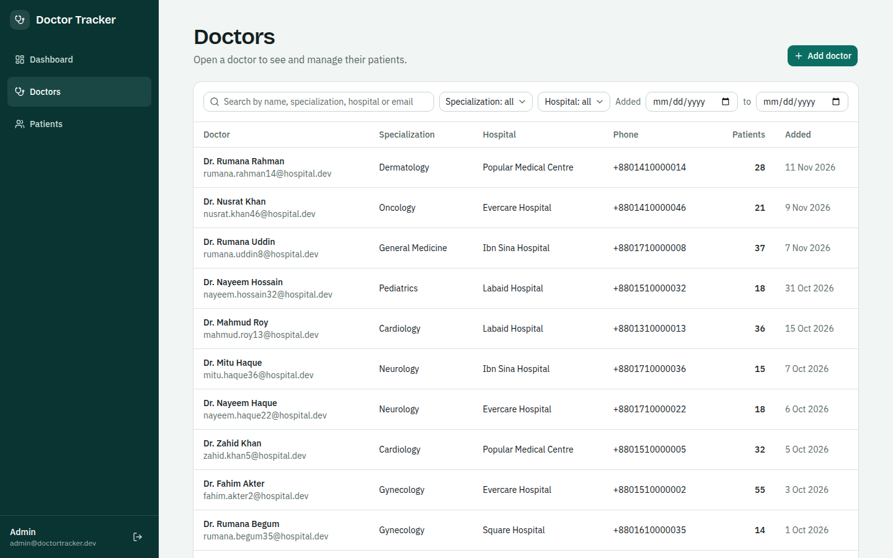
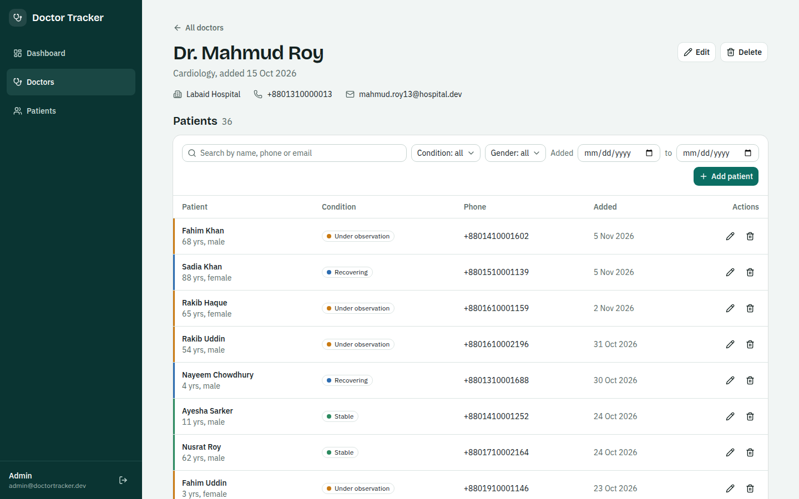
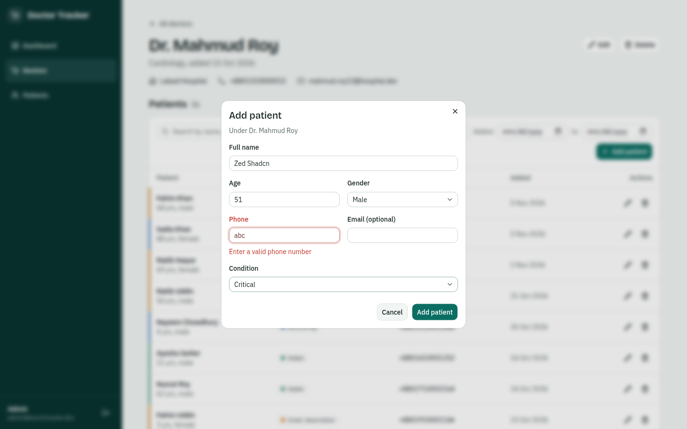
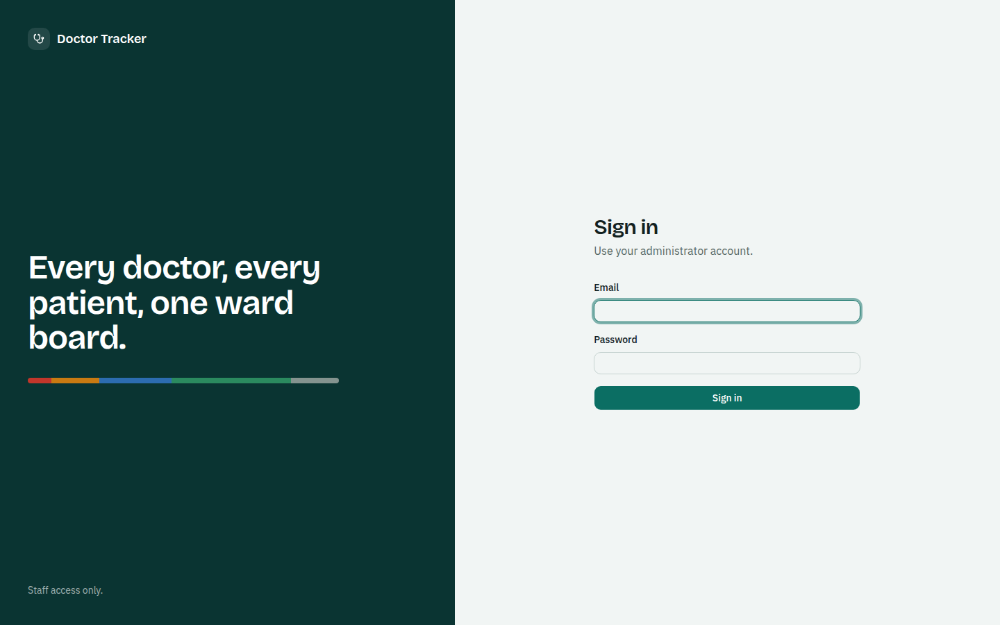
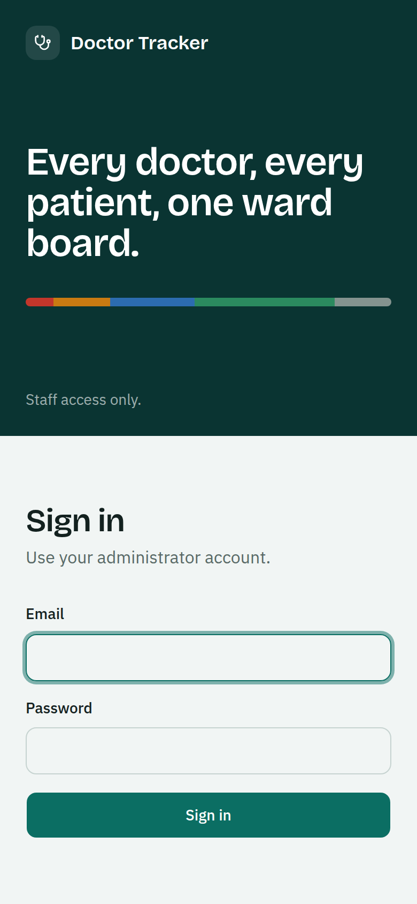
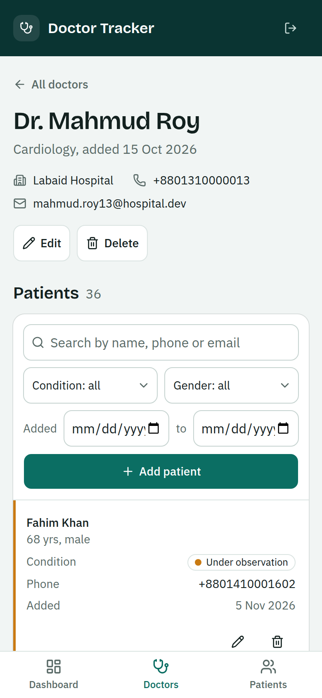
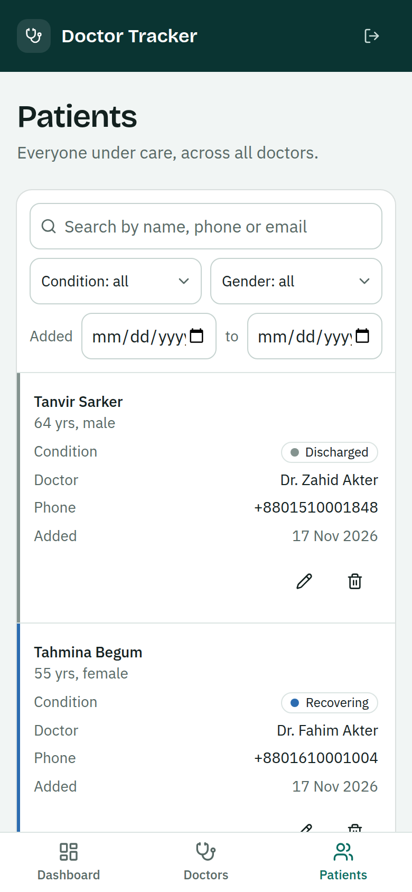

# Doctor Tracker

## Description

Doctor Tracker is a secure admin portal for hospital staff to manage doctors and the patients under their care. An administrator signs in, adds doctors, opens any doctor to add or remove their patients, and works through the full patient list with search, filters and pagination. A dashboard turns the same data into a ward-board view: how many patients each doctor carries, how many are critical right now, and how admissions move day by day. It is built as two independent applications, a Next.js client and an Express REST API on MongoDB, with every list query backed by an index.

## Setup Guide

Requirements: Node.js 20.19+ and Docker (or any MongoDB 6+ instance).

The repository holds two separate applications. Each has its own `package.json`, dependencies and `.env`; there is no root package or workspace.

```
.
├── client/              Next.js app (UI)
├── server/              Express REST API
├── docker-compose.yml   MongoDB for local development
└── docs/screenshots/
```

**1. Start MongoDB**

```bash
docker compose up -d
```

**2. Start the API** (terminal 1)

```bash
cd server
cp .env.example .env      # then set JWT_SECRET to a random string of 32+ characters
npm install
npm run seed              # creates the admin user and demo data (48 doctors, 1,200 patients)
npm run dev               # http://localhost:4000
```

**3. Start the client** (terminal 2)

```bash
cd client
cp .env.example .env.local
npm install
npm run dev               # http://localhost:3000
```

**4. Sign in** at http://localhost:3000 with the seeded account:

| Email | Password |
| --- | --- |
| `admin@doctortracker.dev` | `Admin@12345` (full access) |
| `staff@doctortracker.dev` | `Staff@12345` (view only) |

Both are also one-click buttons under "or try a demo account" on the sign-in screen.

Both values can be changed with `SEED_ADMIN_EMAIL` / `SEED_ADMIN_PASSWORD` in `server/.env` before seeding.

### Environment variables

| File | Variable | Purpose |
| --- | --- | --- |
| `server/.env` | `MONGO_URI` | MongoDB connection string |
| | `JWT_SECRET` | Signs session tokens. Minimum 32 characters; the server refuses to boot without it |
| | `JWT_EXPIRES_IN_HOURS` | Session lifetime (default 8) |
| | `CLIENT_ORIGIN` | Origin allowed by CORS (default `http://localhost:3000`) |
| | `PORT` | API port (default 4000) |
| `client/.env.local` | `API_URL` | Where the client forwards `/api/*` (default `http://localhost:4000`) |

### Scripts

| | `server/` | `client/` |
| --- | --- | --- |
| Develop | `npm run dev` | `npm run dev` |
| Test | `npm test` | `npm test` |
| Type-check | `npm run typecheck` | `npm run typecheck` |
| Production | `npm run build && npm start` | `npm run build && npm start` |

### Tests

The project was built test-first: each API endpoint and each reusable client unit had a failing test before its implementation.

- **Server, 36 tests** (Vitest + Supertest against an in-memory MongoDB): authentication and authorization, validation errors, doctor and patient CRUD, search, every filter, pagination, dashboard aggregation, and a query-plan test that fails if a list or search query falls back to a collection scan.
- **Client, 19 tests** (Vitest + Testing Library): the API wrapper, query-string and pagination helpers, and the `ListPagination`, `SearchInput`, `DataTable` and `LoginForm` components. These tests were written against the original hand-built components and passed unchanged after the move to shadcn/ui, which is what confirmed the migration kept behaviour intact.

The first server test run downloads a MongoDB binary (about 100 MB, cached afterwards).

## System Architecture

```
 Browser
    │  same-origin requests, httpOnly session cookie
    ▼
 Next.js client  :3000
    ├─ proxy.ts            no session cookie → redirect to /login
    ├─ pages (App Router)  static shell + client components
    │     └─ TanStack Query: cache, dedupe, background refetch
    └─ rewrite /api/*  ─────────────────────────────┐
                                                    ▼
                                      Express REST API  :4000
                                        helmet → cors → json → cookies
                                        ├─ /api/auth       login, logout, me (rate-limited)
                                        ├─ requireAuth     verify JWT
                                        ├─ requireRole     admin only
                                        ├─ /api/doctors    + /:id/patients
                                        ├─ /api/patients
                                        ├─ /api/dashboard  aggregation pipelines
                                        └─ error handler   one JSON error shape
                                                    │  Mongoose
                                                    ▼
                                               MongoDB
                                      users · doctors · patients
```

**Request flow.** The browser only ever talks to the Next.js origin. Requests to `/api/*` are forwarded to the Express server by a Next.js rewrite. The API validates input with Zod, runs an indexed query, and answers in one of two shapes: `{ data, meta? }` on success or `{ error: { code, message, details? } }` on failure. TanStack Query caches the response under a key built from the resource and the URL parameters.

**Authentication.** `POST /api/auth/login` checks the bcrypt hash and sets a JWT in an `httpOnly`, `SameSite=Lax` cookie (also `Secure` in production). JavaScript cannot read it, and it is not sent on cross-site POSTs. Protection is layered:

1. `proxy.ts` in the client redirects visitors without a session cookie to `/login` before any page renders. This is a convenience, not a security boundary.
2. Every resource route on the API passes `requireAuth` (valid JWT) and `requireRole('admin')`. This is the security boundary.
3. If a session expires mid-use, the API answers 401 and clears the cookie; the client sends the user to `/login` and returns them to the page they were on.

Login is rate-limited to 20 attempts per 15 minutes per IP, and an unknown email costs the same bcrypt comparison as a wrong password, so response time does not reveal which emails exist.

**REST endpoints**

| Method | Path | Purpose |
| --- | --- | --- |
| POST | `/api/auth/login` · `/api/auth/logout` | Start and end a session |
| GET | `/api/auth/me` | Current user |
| GET, POST | `/api/doctors` | List (search, filters, pagination) · create |
| GET | `/api/doctors/filters` | Distinct specializations and hospitals |
| GET, PATCH, DELETE | `/api/doctors/:id` | Read · update · delete (with their patients) |
| GET, POST | `/api/doctors/:id/patients` | A doctor's patients · add a patient under the doctor |
| DELETE | `/api/doctors/:id/patients/:patientId` | Remove a patient from that doctor's list |
| GET | `/api/patients` | List (search, filters, pagination) |
| PATCH, DELETE | `/api/patients/:id` | Edit · delete |
| GET | `/api/dashboard/stats?days=30` | Totals, breakdowns and daily timeline |

List endpoints accept `page`, `limit` (max 100), `search`, `from`, `to`, plus `specialization` and `hospital` for doctors, and `condition`, `gender` and `doctor` for patients.

**Code layout**

```
server/src
├── app.ts               middleware and route wiring
├── server.ts            connect to MongoDB, listen, graceful shutdown
├── config/env.ts        environment validation (fails fast)
├── middleware/          auth (JWT, roles), error handler
├── modules/
│   ├── auth/            user model, login/logout/me
│   ├── doctors/         model + indexes, service (queries), routes
│   ├── patients/        model + indexes, service, routes
│   └── dashboard/       aggregation pipelines
├── utils/               search tokens, pagination, shared Zod pieces
└── scripts/seed.ts

client/src
├── proxy.ts             optimistic route protection
├── app/                 routes: /login, / (dashboard), /doctors, /doctors/[id], /patients
├── features/            auth, doctors, patients, dashboard (forms, lists, charts)
├── components/ui/       shadcn/ui primitives (Button, Dialog, Select, Table, Sidebar, Chart…)
├── components/app/      app components composed from them: DataTable, ListPagination,
│                        SearchInput, filters, form fields, dialogs
├── components/shell/    shadcn Sidebar (desktop) and tab bar (mobile)
├── hooks/               URL list state, form submission
└── lib/                 API client, query hooks, types, formatting
```

## Technical Decisions

### 1. Search with indexed prefix tokens instead of `$regex` or `$text`

The search boxes are search-as-you-type across several fields (a doctor's name, specialization, hospital, email and phone). The two obvious MongoDB options both fall short:

- **Case-insensitive `$regex` on each field** (`{ name: /car/i }` in an `$or`) gives the right behaviour but cannot use an index. Every keystroke scans the whole collection, and the cost grows linearly with the data.
- **A `$text` index** is fast but matches whole words only. Typing `cardio` finds nothing until the user finishes typing `cardiology`, which is poor UX for a live search box.

Instead, each document stores a `searchTokens` array: the lowercased words of its searchable fields, written by a Mongoose `pre('validate')` hook and covered by a multikey index. A query is split into terms and each term becomes an anchored, case-sensitive prefix match:

```js
// "neuro ibn" →
{ $and: [{ searchTokens: /^neuro/ }, { searchTokens: /^ibn/ }] }
```

An anchored prefix regex on an indexed field is answered with an index range scan, so the search is both partial-word and index-backed. User input is regex-escaped, and the number of terms is capped at five.

Trade-offs: slightly larger documents and one extra index to maintain on writes; matching is by word prefix, not arbitrary substring (`ology` will not find `Cardiology`); and updates must go through `save()` so the hook runs, which the services do. A test asserts through `explain()` that search and filtered lists never use a `COLLSCAN`. If typo tolerance or relevance ranking is needed later, Atlas Search is the next step, and only `utils/search.ts` would change.

The other indexes follow the equality, sort, range rule. Every list is sorted newest first, so each filter index ends in `createdAt` (`{ specialization: 1, createdAt: -1 }`, `{ doctor: 1, createdAt: -1 }`, `{ condition: 1, createdAt: -1 }`), which lets MongoDB return a filtered page already sorted, with no in-memory sort. Patient counts for a page of doctors come from one grouped query over the `doctor` index rather than a `$lookup` per row.

### 2. TanStack Query with URL state instead of Redux, behind a same-origin API proxy

Almost all state in this app is server state: lists, a doctor, dashboard numbers. Redux would mean hand-writing loading, error, caching and invalidation logic for each of them. TanStack Query provides those as a cache keyed by request:

- **Smooth pagination.** `keepPreviousData` keeps the current page visible, dimmed, while the next one loads, so the table never collapses into a spinner.
- **Fewer requests.** Results stay fresh for 30 seconds; going back to a page paints from cache. In-flight requests are cancelled when filters change.
- **Simple, correct invalidation.** Any write marks doctors, patients and dashboard stale, because counts appear in all three. Only queries on screen actually refetch.

The remaining UI state, which is search text, filters and page number, lives in the URL (`/patients?condition=critical&page=2`) through a small `useListParams` hook. A filtered view survives reload, works with the back button and can be shared as a link, and the dashboard's condition tiles are plain links into a pre-filtered patient list. Search input is debounced by 300 ms, so typing does not issue a request per keystroke. With the URL as the single source of truth there is no global client store at all.

The client reaches the API through a Next.js rewrite (`/api/*` to the Express server) rather than calling it cross-origin. The frontend and backend remain separate deployable applications that communicate over REST, but from the browser's point of view there is one origin. That keeps the session cookie first-party, so `SameSite=Lax` works without `SameSite=None`, and removes CORS preflight requests. The cost is one extra network hop through the Next.js server.

### UI components: shadcn/ui

The interface is built from [shadcn/ui](https://ui.shadcn.com) components (Radix primitives, Tailwind CSS v4). The generated primitives live untouched in `components/ui`; anything specific to this app is composed from them in `components/app`, so a primitive can be regenerated without losing app code.

- **Theming is done once, in tokens.** `globals.css` maps shadcn's semantic variables (`--primary`, `--border`, `--sidebar`, `--chart-1`…) to the Doctor Tracker palette. No component carries a hard-coded colour, so Button, Select, Dialog, Sidebar and Chart are all on-brand with no per-component overrides.
- **Accessibility comes from Radix.** Dialogs trap focus and close on Escape, the delete confirmation is an `AlertDialog` that cannot be dismissed by clicking outside, and selects are fully keyboard operable. Every icon-only button has an `aria-label`, and conditions are shown as a colour plus a text label, never colour alone.
- **Touch targets.** shadcn's controls are compact for desktop density; on touch devices (`pointer: coarse`) a single CSS rule raises buttons, inputs and selects to the 44px minimum.
- **Forms** use shadcn `Field`, `Input` and `Select` inside native `<form>` elements. Radix Select renders a hidden native select when given a `name`, so values submit through `FormData` and no form library is needed. Server validation errors are shown under the matching field.
- **Charts** use shadcn's `ChartContainer` and tooltip over Recharts, loaded with `next/dynamic` so the charting code is only downloaded on the dashboard.

### Scalability notes

- **Stateless API.** The JWT carries the session, so API instances can be added behind a load balancer. The login rate limiter is in-memory and should move to a shared store such as Redis when running more than one instance.
- **Pagination.** Lists use `skip`/`limit` because the UI needs numbered pages and a total. Deep pages get slower with `skip`; for very large collections, switch to cursor pagination on `(createdAt, _id)`.
- **Dashboard.** Aggregations run in the database in parallel and return only summaries. Totals use `estimatedDocumentCount`, which reads collection metadata. The per-condition and per-doctor groupings scan the patients collection; at millions of rows, cache the response for a short time or maintain counters.
- **Deleting a doctor** removes their patients in a second statement without a transaction, because transactions need a replica set. On Atlas or any replica set, wrap both in a session.
- **Indexes** are built automatically in development. In production `autoIndex` is off; build them as a deployment step.

## Visual Evidence

### Desktop

| Dashboard | Doctors |
| --- | --- |
|  |  |

| Doctor and their patients | Patients |
| --- | --- |
|  |  |

| Add patient (server validation error shown on the field) | Sign in |
| --- | --- |
|  |  |

### Mobile

| Sign in | Dashboard | Doctors | Doctor detail | Patients |
| --- | --- | --- | --- | --- |
|  |  |  |  |  |

On phones the sidebar becomes a bottom tab bar and each table reflows into stacked records. The same HTML table is restyled with CSS, so there is no duplicate mobile markup. The coloured stripe on each patient row is their condition, using one triage scale across the whole app: red critical, amber under observation, blue recovering, green stable, grey discharged.
