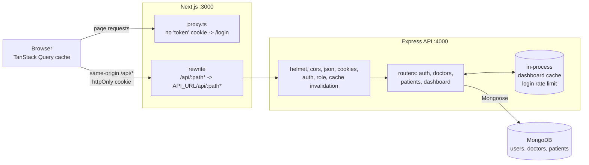
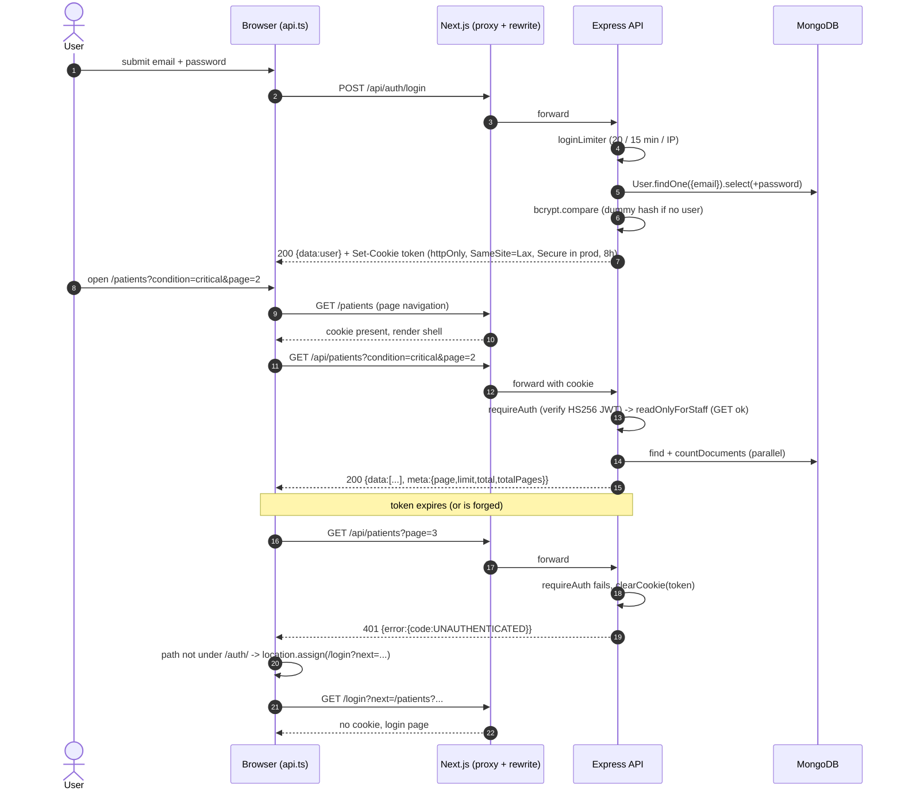
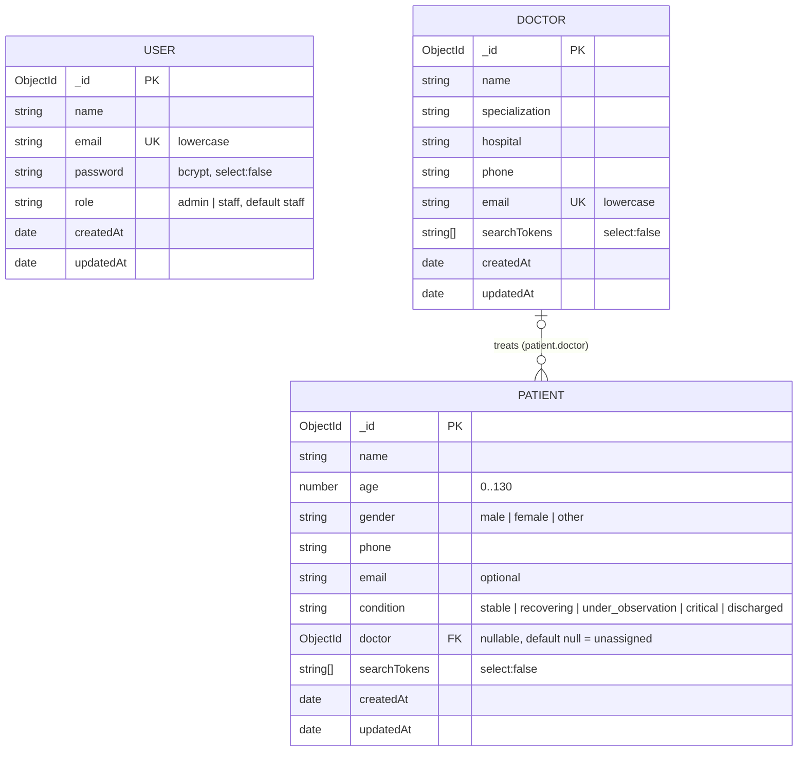
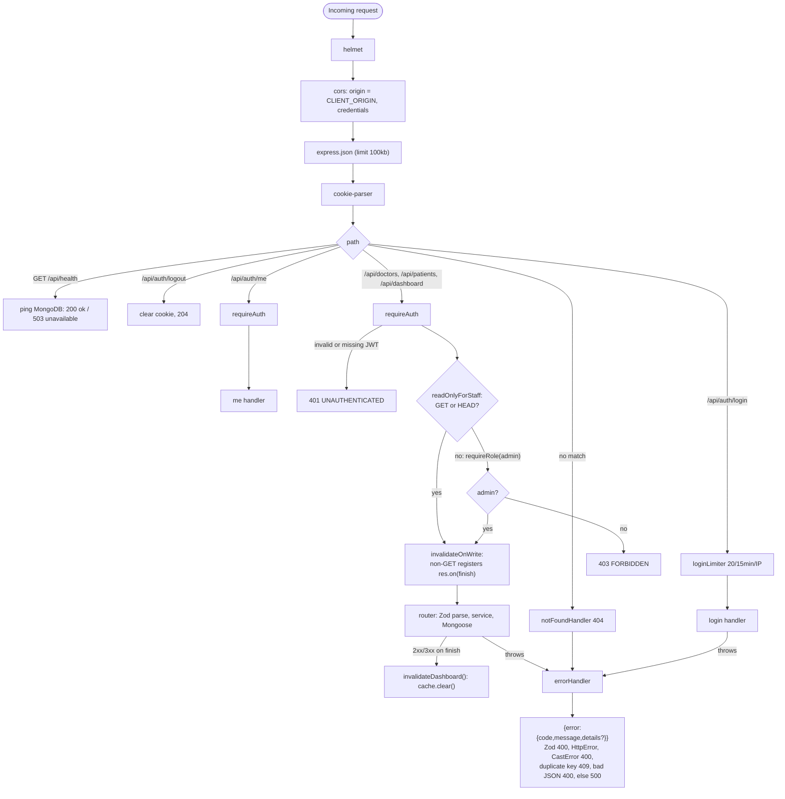

# Architecture

CareRoster is two independent applications: a Next.js client (`client/`) and an Express 5 REST API (`server/`) on MongoDB. Everything below was checked against the source in `server/src`, `client/src/lib`, `client/next.config.ts` and `client/src/proxy.ts`.

## 1. System / container view

The browser only talks to the Next.js origin. Page navigations pass through `proxy.ts`, which redirects visitors without a `token` cookie to `/login` (a UX shortcut, not a security boundary; the matcher excludes `/api`). Requests to `/api/*` are forwarded by a Next.js rewrite to `API_URL` (default `http://localhost:4000`). Because the cookie is first-party, `SameSite=Lax` is enough and CORS preflights do not occur. The API still configures `cors` with `CLIENT_ORIGIN` and `credentials: true` for direct calls.

## 2. Sequence: login, authenticated list, 401 expiry

`api.ts` is the only place that calls the API. On any 401 from a path that does not start with `/auth/`, it does a full-page navigation to `/login?next=<current path+query>`, which also clears stale client state. Paths under `/auth/` (login, `me`) are excluded from the redirect, so a wrong password or a failed `me` call surfaces as an error instead of a redirect loop. Retry policy in `providers.tsx`: never retry 4xx, retry network/5xx errors at most twice.

## 3. Data model

`USER` has no relation to the other collections; it only authenticates the portal.

Indexes (all declared on the schemas; `autoIndex` is on except when `NODE_ENV=production`):

| Collection | Index | Serves |
| --- | --- | --- |
| users | `{email: 1}` unique | login lookup |
| doctors | `{email: 1}` unique | duplicate check (409) |
| doctors | `{createdAt: -1, _id: -1}` | default list, date range |
| doctors | `{specialization: 1, createdAt: -1, _id: -1}` | specialization filter |
| doctors | `{hospital: 1, createdAt: -1, _id: -1}` | hospital filter |
| doctors | `{searchTokens: 1}` (multikey) | prefix search |
| patients | `{createdAt: -1, _id: -1}` | default list, date range |
| patients | `{doctor: 1, createdAt: -1, _id: -1}` | a doctor's patients, per-doctor counts, `unassigned` (`doctor: null`) |
| patients | `{condition: 1, createdAt: -1, _id: -1}` | condition filter |
| patients | `{searchTokens: 1}` (multikey) | prefix search |

There is no `gender` index; the gender filter is applied on top of whatever index the planner picks.

`patient.doctor` is nullable: `null` means unassigned. Deleting a doctor first sets `doctor: null` on all their patients, then deletes the doctor (no transaction, see ADR 0006). A patient can be reassigned (`PATCH /api/patients/:id` with `doctor`) or unassigned (`doctor: null`).

## 4. Request lifecycle

Notes that follow from the code:

- `requireAuth` reads the `token` cookie, verifies it as HS256 with `JWT_SECRET`, and sets `req.user = {id, role}` from the token. The role is not re-read from the database on each request, so a role change takes effect on the next login (ADR 0007).
- `readOnlyForStaff` is applied to the whole `/api/doctors`, `/api/patients` and `/api/dashboard` prefixes, so any future non-GET route is admin-only by default.
- `invalidateOnWrite` sits after the role check, so a 403 never reaches it; it clears the cache only when the final status is below 400.
- Only login has a rate limit. There is no global limiter.
- `trust proxy` is set to 1 so the per-IP limiter sees the client IP behind the rewrite or a load balancer.

## 5. Role model

| Role | Reads (GET/HEAD) | Writes (POST/PATCH/DELETE) |
| --- | --- | --- |
| `admin` | yes | yes |
| `staff` (default for new users) | yes | 403 `FORBIDDEN` |
| unauthenticated | 401 | 401 |

Enforcement is in the API. The client hides write controls from staff (`useCanWrite` in `client/src/lib/queries.ts`, true only for `admin`), but that is presentation only. Roles are stored on the user and copied into the JWT at login. The seed script creates one admin and one staff account.

## 6. Dashboard cache

`GET /api/dashboard/stats?days=N` (N from 1 to 365, default 30) runs several aggregations. The finished response body is cached in a process-local `Map` keyed by `days`.

| Property | Behaviour |
| --- | --- |
| TTL | 60 seconds, checked on read |
| Key | the `days` value (one entry per range) |
| Invalidation | `cache.clear()` after any non-GET/HEAD request that finishes with status below 400, from any of the three protected prefixes |
| Scope | one Node process |

Limitations: with more than one API instance, a write on instance A does not clear instance B, so B can serve data up to 60 seconds old. Writes that bypass the API (seed script, direct database edits) are only picked up when the TTL expires. A restart empties the cache. The client adds its own layer: TanStack Query invalidates `doctors`, `patients` and `dashboard` keys after each successful mutation, and uses a 30 second default `staleTime`.
