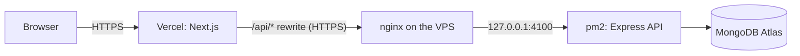

# Deployment

CareRoster deploys as two pieces:

| Piece | Where | How | Trigger |
| --- | --- | --- | --- |
| `client/` (Next.js) | Vercel | Vercel's Git integration (no workflow needed) | push to `master` (production), any other branch (preview) |
| `server/` (Express API) | VPS, under pm2 | [`prod-deploy-api.yml`](../.github/workflows/prod-deploy-api.yml) | push to `master` touching `server/**`, or run by hand from the Actions tab |

[`ci.yml`](../.github/workflows/ci.yml) runs the full test suite on every push and pull request; the API deploy workflow only type-checks and builds, so keep branch protection on `master` requiring CI.



The browser only ever talks to the Vercel origin. Vercel forwards `/api/*` to the VPS, so the session cookie stays first-party and the API needs no CORS for browsers ([ADR 0003](adr/0003-same-origin-api-and-httponly-cookie.md)).

## GitHub configuration (API only)

Create an environment named **production** (Settings → Environments) and add the following. The client needs nothing in GitHub.

**Secrets**

| Name | Value |
| --- | --- |
| `HOST` | VPS IP or hostname |
| `SERVER_USERNAME` | SSH user (the workflow deploys to `/root/carerooster-api/`, so `root` unless you change the path) |
| `SSH_PRIVATE_KEY` | Private key whose public half is in the VPS user's `authorized_keys` |
| `MONGO_URI` | MongoDB connection string, database name included |
| `JWT_SECRET` | Random string of 32+ characters: `openssl rand -hex 32` |

**Variables**

| Name | Value |
| --- | --- |
| `CLIENT_ORIGIN` | The Vercel URL, e.g. `https://carerooster.vercel.app` (no trailing slash) |
| `TRUST_PROXY` | Proxies in front of the API, default `1`. With Cloudflare and nginx in front it is `3` (see below) |

## How the API workflow works

It follows the same shape as the other projects: render the environment file, build, copy, restart.

1. **Generate `.env`.** `server/.env.example` is the template: it holds `$NAME` placeholders. `envsubst` fills them from the workflow's `env:` block (which reads the secrets and variables above) and writes `server/.env`, which is git-ignored. A new variable needs a `$NAME` line in `.env.example` and a matching entry in the workflow's `env:` block. The server refuses to start while `MONGO_URI` or `JWT_SECRET` still start with `$`, so a copy that was never filled in fails loudly instead of running half-configured. Locally you do the same by hand: `cp .env.example .env` and replace each placeholder.
2. **Build.** `npm ci`, type-check, `npm run build` (compiles to `dist/`), then `npm prune --omit=dev`.
3. **Copy.** `dist/`, `node_modules/`, `.env`, `package.json` and `ecosystem.config.js` go to `/root/carerooster-api/` over SCP (the folder is emptied first).
4. **Restart.** pm2 stops and deletes the old process, starts `ecosystem.config.js --env production`, saves the process list, then the workflow calls `/api/health` on the VPS and fails the run if MongoDB is not reachable.

The API runs as **one** pm2 process on purpose: the dashboard cache and the rate limits live in memory ([ADR 0007](adr/0007-dashboard-in-memory-cache.md)). Raise `instances` only after moving both to Redis ([trade-offs](trade-offs.md)).

## One-time VPS setup

```bash
# Node 22 and pm2
curl -fsSL https://deb.nodesource.com/setup_22.x | sudo -E bash - && sudo apt-get install -y nodejs nginx
sudo npm install --global pm2
pm2 startup        # run the command it prints so pm2 survives a reboot

# Firewall: SSH and web only; the API port stays private behind nginx
sudo ufw allow OpenSSH && sudo ufw allow 'Nginx Full' && sudo ufw enable
```

Allow the VPS IP in MongoDB Atlas (Network Access).

**TLS is required.** Vercel sends login requests, including passwords, to the API; over plain `http` they cross the internet unencrypted. Point a domain at the VPS and terminate TLS in nginx. The API listens on **4100**, not 4000, because 4000 is already taken by another app on the same VPS (`ss -ltnp` shows what is free). This is the site file in use, `/etc/nginx/sites-available/care-roster-api.porphy.tech`, symlinked into `sites-enabled`:

```nginx
server {
    listen 80;
    listen [::]:80;
    server_name care-roster-api.porphy.tech;
    return 301 https://$host$request_uri;
}

server {
    listen 443 ssl;
    listen [::]:443 ssl;
    server_name care-roster-api.porphy.tech;

    ssl_certificate     /etc/ssl/porphy_tech_cert.pem;      # Cloudflare Origin certificate, *.porphy.tech
    ssl_certificate_key /etc/ssl/porphy_tech_key.pem;
    ssl_protocols TLSv1.2 TLSv1.3;
    client_max_body_size 1m;

    location / {
        proxy_pass http://127.0.0.1:4100;
        proxy_http_version 1.1;
        proxy_set_header Host $host;
        proxy_set_header X-Real-IP $remote_addr;
        proxy_set_header X-Forwarded-For $proxy_add_x_forwarded_for;
        proxy_set_header X-Forwarded-Proto $scheme;
    }
}
```

```bash
sudo nginx -t && sudo nginx -s reload
```

The certificate is a Cloudflare Origin CA certificate, which only Cloudflare trusts, so the DNS record must be **proxied** (orange cloud) and the zone's SSL/TLS mode must be **Full (strict)**; browsers and Vercel then see Cloudflare's public certificate. Check that no zone-wide Redirect Rule or Page Rule sends this hostname elsewhere (a `301` to another site from `cloudflare` means the request never reached nginx).

Set the GitHub variable `TRUST_PROXY` to the number of proxies in front of the API, otherwise every visitor shares one IP and the per-IP rate limits trip for everyone at once. Vercel → Cloudflare → nginx → API is **3**; without Cloudflare (DNS only) it is 2; with no nginx and the API exposed directly it is 1.

## Vercel setup

Vercel deploys the client from its own Git integration, so there is no workflow for it.

1. Import the repository in Vercel and set **Root Directory** to `client` (framework: Next.js).
2. Set **Production Branch** to `master`.
3. Add the environment variable `API_URL` (Production, and Preview if you want previews to work) with the API's public base URL, e.g. `https://api.example.com`, no trailing slash. It is baked into the build (the `/api/*` rewrite in `next.config.ts`), so redeploy after changing it.

Every push to `master` becomes a production deployment; other branches get preview URLs.

## First deploy: indexes and data

Run once on the VPS (`.env` is read from the current directory, so `cd` first):

```bash
cd /root/carerooster-api
NODE_ENV=production node dist/scripts/db-indexes.js          # create indexes (autoIndex is off in production)
# Optional demo data and the two demo accounts. WIPES the database; refuses to run without the flag.
NODE_ENV=production SEED_ALLOW_PRODUCTION=true node dist/scripts/seed.js
```

Re-run `db-indexes.js` after a deploy that changes an index (the build output already includes it). `node dist/scripts/db-explain.js` prints the query plans against the production database.

## Checks after a deploy

```bash
curl -fsS https://api.example.com/api/health        # {"status":"ok"}
pm2 status && pm2 logs carerooster-api --lines 50   # on the VPS
```

Then sign in from the Vercel URL. A `401` right after sign-in usually means `CLIENT_ORIGIN`/`API_URL` do not match the real URLs; a `502` from Vercel means the API is not reachable from the internet.

## Rolling back

Re-run the workflow from an earlier commit (Actions → the workflow → Run workflow on that ref), or `git revert` and push. Vercel also keeps every deployment for an instant promote-previous from its dashboard.
